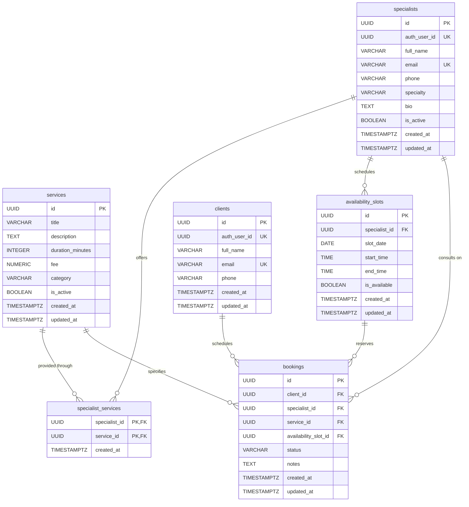

# Database Schema & Technical Architecture
## Smart Appointment & Consultation Booking Platform (Supabase PostgreSQL)

---

## 1. System Overview

The **Smart Appointment & Consultation Booking Platform** database is architected on Supabase PostgreSQL under strict 3NF (Third Normal Form) relational principles. It supports high-concurrency consultation bookings, specialist cataloging, calendar availability scheduling, and absolute prevention of double-booking at the database engine layer.

---

## 2. Entity-Relationship Diagram (ERD)



---

## 3. Data Dictionary & Table Specifications

### 3.1 `services`
Stores the services offered across the platform.

| Column | Data Type | Constraints | Description |
|---|---|---|---|
| `id` | UUID | PK, DEFAULT `gen_random_uuid()` | Unique service identifier |
| `title` | VARCHAR(150) | NOT NULL | Service title |
| `description` | TEXT | NULL | Service description & preparation notes |
| `duration_minutes` | INTEGER | NOT NULL, `> 0` | Consultation length in minutes |
| `fee` | NUMERIC(10, 2) | NOT NULL, `>= 0.00` | Consultation price |
| `category` | VARCHAR(100) | NOT NULL | Department / Category |
| `is_active` | BOOLEAN | NOT NULL, DEFAULT `true` | Catalog visibility flag |
| `created_at` | TIMESTAMPTZ | NOT NULL, DEFAULT `NOW()` | Timestamp created |
| `updated_at` | TIMESTAMPTZ | NOT NULL, DEFAULT `NOW()` | Timestamp last updated |

---

### 3.2 `specialists`
Stores specialist professional profiles.

| Column | Data Type | Constraints | Description |
|---|---|---|---|
| `id` | UUID | PK, DEFAULT `gen_random_uuid()` | Unique specialist identifier |
| `auth_user_id` | UUID | UNIQUE, NULL, FK to `auth.users(id)` | Future Supabase Auth account link |
| `full_name` | VARCHAR(150) | NOT NULL | Specialist full legal name |
| `email` | VARCHAR(255) | NOT NULL, UNIQUE, Regex check | Contact email address |
| `phone` | VARCHAR(50) | NULL | Contact phone number |
| `specialty` | VARCHAR(100) | NOT NULL | Clinical or consulting specialty |
| `bio` | TEXT | NULL | Professional biography |
| `is_active` | BOOLEAN | NOT NULL, DEFAULT `true` | Platform active status |
| `created_at` | TIMESTAMPTZ | NOT NULL, DEFAULT `NOW()` | Timestamp registered |
| `updated_at` | TIMESTAMPTZ | NOT NULL, DEFAULT `NOW()` | Timestamp last updated |

---

### 3.3 `clients`
Stores client profile information.

| Column | Data Type | Constraints | Description |
|---|---|---|---|
| `id` | UUID | PK, DEFAULT `gen_random_uuid()` | Unique client identifier |
| `auth_user_id` | UUID | UNIQUE, NULL, FK to `auth.users(id)` | Future Supabase Auth account link |
| `full_name` | VARCHAR(150) | NOT NULL | Client full name |
| `email` | VARCHAR(255) | NOT NULL, UNIQUE, Regex check | Client email address |
| `phone` | VARCHAR(50) | NULL | Client phone number |
| `created_at` | TIMESTAMPTZ | NOT NULL, DEFAULT `NOW()` | Timestamp registered |
| `updated_at` | TIMESTAMPTZ | NOT NULL, DEFAULT `NOW()` | Timestamp last updated |

---

### 3.4 `specialist_services`
Many-to-many junction table between specialists and consultation services.

| Column | Data Type | Constraints | Description |
|---|---|---|---|
| `specialist_id` | UUID | PK (composite), FK to `specialists(id)` | Specialist offering the service |
| `service_id` | UUID | PK (composite), FK to `services(id)` | Service provided |
| `created_at` | TIMESTAMPTZ | NOT NULL, DEFAULT `NOW()` | Timestamp associated |

---

### 3.5 `availability_slots`
Maintains schedule time blocks per specialist.

| Column | Data Type | Constraints | Description |
|---|---|---|---|
| `id` | UUID | PK, DEFAULT `gen_random_uuid()` | Slot unique identifier |
| `specialist_id` | UUID | NOT NULL, FK to `specialists(id)` | Specialist owning this slot |
| `slot_date` | DATE | NOT NULL | Slot calendar date |
| `start_time` | TIME | NOT NULL | Slot start time |
| `end_time` | TIME | NOT NULL, `> start_time` | Slot end time |
| `is_available` | BOOLEAN | NOT NULL, DEFAULT `true` | Availability state flag |
| `created_at` | TIMESTAMPTZ | NOT NULL, DEFAULT `NOW()` | Timestamp created |
| `updated_at` | TIMESTAMPTZ | NOT NULL, DEFAULT `NOW()` | Timestamp last updated |

**Special Constraints on `availability_slots`:**
- Compound Key: `UNIQUE (id, specialist_id)` for compound foreign key integrity with `bookings`.
- Exclusion Constraint:
  ```sql
  CONSTRAINT uq_no_overlapping_specialist_slots EXCLUDE USING gist (
      specialist_id WITH =,
      slot_date WITH =,
      tsrange((slot_date + start_time), (slot_date + end_time)) WITH &&
  );
  ```

---

### 3.6 `bookings`
Captures appointment reservations.

| Column | Data Type | Constraints | Description |
|---|---|---|---|
| `id` | UUID | PK, DEFAULT `gen_random_uuid()` | Booking unique identifier |
| `client_id` | UUID | NOT NULL, FK to `clients(id)` | Booking client |
| `specialist_id` | UUID | NOT NULL, FK to `specialists(id)` | Assigned specialist |
| `service_id` | UUID | NOT NULL, FK to `services(id)` | Requested service |
| `availability_slot_id` | UUID | NOT NULL, FK to `availability_slots(id)` | Reserved slot |
| `status` | VARCHAR(20) | NOT NULL, DEFAULT `'Pending'` | Status: `Pending`, `Confirmed`, `Completed`, `Cancelled` |
| `notes` | TEXT | NULL | Clinical / appointment notes |
| `created_at` | TIMESTAMPTZ | NOT NULL, DEFAULT `NOW()` | Timestamp created |
| `updated_at` | TIMESTAMPTZ | NOT NULL, DEFAULT `NOW()` | Timestamp updated |

---

## 4. Referential & Relational Integrity Guardrails

1. **Service Offering Validation (`fk_booking_specialist_service_relationship`)**:
   `FOREIGN KEY (specialist_id, service_id) REFERENCES specialist_services(specialist_id, service_id)`
   Ensures that no client can book a specialist for a service that the specialist does not offer.

2. **Slot Ownership Validation (`fk_booking_slot_specialist_relationship`)**:
   `FOREIGN KEY (availability_slot_id, specialist_id) REFERENCES availability_slots(id, specialist_id)`
   Ensures that the booked slot physically belongs to the designated specialist.

---

## 5. Double-Booking Prevention Architecture

Double-booking prevention is enforced at three distinct layers:

### Layer 1: PostgreSQL Partial Unique Index
```sql
CREATE UNIQUE INDEX idx_unique_active_slot_booking
    ON bookings (availability_slot_id)
    WHERE (status IN ('Pending', 'Confirmed'));
```
- Active bookings (`Pending`, `Confirmed`) lock the slot at the index level.
- Two transactions attempting to reserve the same slot concurrently will result in an immediate constraint violation (`unique_violation`).
- Updating status to `'Cancelled'` frees the slot immediately.

### Layer 2: Automatic Slot Synchronization Trigger
The trigger `trg_sync_slot_availability` automatically:
- Sets `availability_slots.is_available = false` on `INSERT` or reschedule.
- Sets `availability_slots.is_available = true` when status becomes `Cancelled`.

### Layer 3: Atomic Stored Procedures (RPCs) with Row-Level Locks
- `book_appointment(...)`: Locks slot with `SELECT ... FOR UPDATE`, checks qualification and availability, inserts booking, and returns structured JSON.
- `cancel_booking(...)`: Locks booking row, updates status to `Cancelled`, and releases the slot.
- `reschedule_booking(...)`: Atomically swaps the old slot for the new slot within a single transaction.

---

## 6. Row-Level Security (RLS) Policy Matrix

| Table | Operation | Target Role | Policy Rule |
|---|---|---|---|
| `services` | SELECT | `public`, `anon` | `is_active = true` |
| `services` | ALL | `service_role` | Full administrative control |
| `specialists` | SELECT | `public`, `anon` | `is_active = true` |
| `specialists` | UPDATE | `authenticated` | `auth.uid() = auth_user_id` |
| `clients` | SELECT | `authenticated` | `auth.uid() = auth_user_id` |
| `clients` | UPDATE | `authenticated` | `auth.uid() = auth_user_id` |
| `clients` | INSERT | `authenticated` | `auth.uid() = auth_user_id` |
| `availability_slots`| SELECT | `public` | `is_available = true AND slot_date >= CURRENT_DATE` |
| `availability_slots`| ALL | `authenticated` (specialist) | Specialist owns slot (`specialist_id` matches profile) |
| `bookings` | SELECT | `authenticated` (client) | `client_id` matches client profile |
| `bookings` | SELECT | `authenticated` (specialist) | `specialist_id` matches specialist profile |
| `bookings` | INSERT | `authenticated` (client) | Client creates for self |
| `bookings` | ALL | `service_role` | Backend full access |

